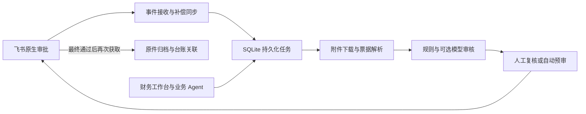

# 有据 · 飞书审批与财务工作台

有据（Youju）是面向飞书原生审批的企业内部财务工作台，支持费用报销与付款申请的票据预审、跨主体查重、人工复核、审批回写和电子原件归档。内置业务 Agent，可通过对话查询审批、核对附件并发起待确认的业务操作。

系统保留企业现有审批流程，在专用预审节点提供审核能力；最终审批状态仍以飞书为准。

付款模板默认开启“仅采集，自动同意”：保留表单、原件、材料正文和发票识别，不执行付款规则审核，存量专用待办也会核对后自动同意。管理员可在“审批接入与规则”逐模板关闭，恢复原审核配置；报销不受影响。详见 [付款流程说明](docs/payment-workflow.md)。

## 核心功能

| 模块 | 能力 |
| --- | --- |
| 审批中心 | 同步报销与付款申请，展示表单、原始附件、审核依据和处理记录，支持人工复核及同意／拒绝预审 |
| 票据识别 | 本地解析 PDF、XML，按需使用腾讯云发票 OCR 与多模态模型，展示字段来源、冲突及人工确认记录 |
| 发票台账 | 企业范围跨主体查重、同票多格式合并、占用管理，支持 CSV／XLSX 历史台账导入与 Excel 导出 |
| 归档中心 | 最终通过后保存原件及版本，按主体、月份等条件检索，提供 ZIP 清单、整单打印及附件选择 |
| 报销统计 | 同页切换报销金额与预算消耗，按部门、员工、类别分析排行、环形占比及堆叠趋势，可下钻单据并导出 Excel |
| 付款统计 | 按飞书最终通过时间统计已支付金额，按项目查看区间金额、截至日累计、排行和趋势，支持下钻及 Excel 导出 |
| 预算管理 | 按主体、申请部门和类别设置月／季／年及自定义周期预算，展示已用、在途、冻结、可用额度及预警，支持归属确认、额度调整留痕和 Excel 导出 |
| 业务 Agent | 流式对话、附件解读、业务查询、操作确认卡、会话持久化及 Token 用量统计 |
| 系统管理 | 飞书网页接入、公司主体、用户角色、模板规则、模型与 OCR 配置、任务重试及审计日志 |

## 快速体验

需要 Git、Docker 和 Docker Compose v2；Windows 可使用启用了 Linux 容器的 Docker Desktop。首次构建会下载依赖以及 Office／OFD 打印转换组件。

在 PowerShell 中执行：

```powershell
git clone git@github.com:OneMobPsycho100/youju-feishu.git
cd youju-feishu
Copy-Item .env.example .env
docker compose up -d --build
```

打开 [http://localhost:18080](http://localhost:18080)，选择“以管理员身份体验”。演示模式自动初始化样例数据，不需要飞书应用、模型或 OCR 凭据。示例原件明确标记为演示用途，业务处理复用正式模式的解析、查重、审核和归档服务。

建议按以下顺序体验：

1. 在审批中心查看样例单据的票面、金额、主体与重复占用证据。
2. 填写意见并“同意预审”，再点击“模拟后续审批通过”。
3. 到归档中心查看原件与 `manifest.json`，尝试选择附件打印或打包下载。
4. 在发票台账下载模板，上传历史台账，完成字段映射、预览与确认导入。

常用命令：

```powershell
docker compose ps
docker compose logs --tail 100 api
docker compose stop
docker compose up -d
```

## 接入真实飞书

### 启动独立实例

真实模式使用 [compose.live.yaml](compose.live.yaml)，包含 API、飞书事件服务和 Web 三个服务，默认只监听本机。它与演示部署使用独立数据卷；二者同时运行时须设置不同的端口。

为真实实例创建独立配置，避免沿用演示密钥：

```powershell
Copy-Item .env.example .env.live
```

编辑 `.env.live`，将以下配置改为：

```dotenv
APP_MODE=live
APP_ENV=development
APP_PORT=18080
APP_PUBLIC_URL=http://127.0.0.1:18080
SESSION_SECRET=
```

`APP_ENV=development` 用于本机 HTTP 安装。`SESSION_SECRET` 留空时，真实实例会自动生成密钥并保存到配置卷；创建后保持该实例密钥不变。其他配置可保留示例默认值。

```powershell
docker compose --env-file .env.live -f compose.live.yaml up -d --build
docker compose --env-file .env.live -f compose.live.yaml logs api
```

打开 [http://127.0.0.1:18080](http://127.0.0.1:18080)，输入 API 首次启动日志中的“YOUJU 安装初始化码”，按网页向导完成绑定：

1. 在飞书开放平台创建企业自建应用，配置可用范围及登录、原生审批读取和操作权限，发布应用。
2. 在工作台填写 App ID／App Secret，将页面给出的 OAuth 回调地址加入飞书应用安全设置。
3. 通过飞书登录绑定企业和首位工作台管理员；其他成员首次登录默认只读，可由管理员授权。
4. 在飞书后台选择长连接接收事件，订阅审批实例与任务事件；工作台的事件服务会读取已保存配置并建立连接。
5. 在“公司主体”配置法定名称、税号及允许别名，再到“审批接入与规则”添加模板。

### 配置专用预审节点

在企业原有审批流程中增加一个由专用审批成员处理的普通人工节点，例如“AI 发票预审”。在工作台粘贴模板链接或编码，确认申请金额、事由、主体、附件等字段映射，以及预审节点和专用审批人身份。

自动审核只在实例实际到达专用预审节点、且存在该审批人的唯一待处理任务时启动，提交申请或其他节点流转仅同步原件及状态。付款仅采集模式也从专用节点开始识别材料，自动同意后继续采集；人工主动重审和最终通过后的归档补审保留各自入口。

新接入模板采用观察模式。先用真实申请验证事件送达、实例与附件读取、专用节点待办、一次同意／拒绝回写及最终归档，再按接入能力启用自动处理。工作台角色授权和飞书应用的接口权限、数据范围均须有效。

自动和手动“增量补偿同步”仅处理最近 7×24 小时内提交、且尚未完成归档的审批，以飞书申请提交时间为准。已完成归档（`ARCHIVED`）的单据直接跳过；部分归档或归档失败的单据仍须满足七天范围。时间或归档条件不符时不下载附件，提交时间缺失时先读取飞书详情确认。飞书实时事件、人工单据刷新及重新归档不受这两项限制，仍可处理旧单的状态变化。

### 公网部署

通过反向代理提供 HTTPS，将 `.env.live` 中的 `APP_ENV` 改为 `production`，并将 `APP_PUBLIC_URL` 改为实际 HTTPS 根地址。API 无需直接暴露到公网，浏览器通过 Web 服务访问 `/api`。

| 用途 | 地址示例 |
| --- | --- |
| 工作台 | `https://finance.example.com` |
| OAuth 回调 | `https://finance.example.com/api/auth/callback` |
| HTTP 事件回调（选择 HTTP 接收方式时） | `https://finance.example.com/api/feishu/events` |

维护接入参数使用“系统管理 → 飞书接入”。长连接不需要公网事件回调；切换 HTTP 接收时，按页面提示配置 Encrypt Key、Verification Token 和回调地址。变更访问地址时，同步更新工作台配置、飞书 OAuth 回调和相应事件地址。

安装码丢失或飞书登录需要恢复时，可在部署终端执行：

```powershell
# 重新生成首次安装码。
docker compose --env-file .env.live -f compose.live.yaml exec api python -m app.setup_access
# 已绑定实例生成短时恢复码，用于登录页的“飞书接入配置恢复”。
docker compose --env-file .env.live -f compose.live.yaml exec api python -m app.setup_access --recovery
```

## 模型、OCR 与业务 Agent

管理员可在“系统管理 → 运行与模型”配置模型服务。接口需兼容流式 Chat Completions；业务 Agent 还需要工具调用能力，票面图像核对需要图像输入能力。

- 填写 API 根地址（例如 `https://model.example.com/v1`，不含 `/chat/completions`）、模型 ID、API Key 和审核要求，先测试连接再保存。
- 模型调用统一使用固定版本的 `deepseek-harness-sdk==0.2.1rc2` 及配套运行时；运行时随 Python 依赖交付，无需另装 Node.js 来运行后端 Agent。
- 结构化输出统一提取完整 JSON，兼容说明文字和 Markdown 围栏，仅清理开头 BOM 与字符串外尾逗号；通过字段及业务校验后采纳，多份有效结果内容不同时保留人工复核。原始输出及解析过程可在 AI 调用日志中查看。
- 未配置模型时仍执行本地解析和确定性规则。模板若要求必须完成模型语义核对，模型缺失或调用失败会进入人工处理。
- 腾讯云发票 OCR 默认关闭，可在同一页面配置具有 `VatInvoiceOCR` 权限的 SecretId／SecretKey，测试样票后启用。
- 附件分类先复用有效结果，再按结构化票据或 PDF 首页文字的组合特征在本地判断；无法确定时，最多发送一张最长边 1024、JPEG 质量 75 的首页／首帧图片给模型。默认发票独立成附件，不探查合同后续页是否夹带发票；分类失败或首页空白时待人工确认。
- 确认为发票后，PDF 优先在本地提取文字和坐标，缺失、歧义或无文字层时再调用多模态模型补读；图片优先使用已启用的发票 OCR，字段不完整时才按同票身份使用模型补缺。分类模型不提取票面字段或统计发票数量，类别确定不代表票面校验或正文读取完成；合同、报价正文按业务需要另行读取。
- 同一审批内内容和格式未变的附件可复用有效的自动分类与票面识别结果，插入、删除或重排附件不会仅因位置变化而重复识别；人工确认仍绑定原附件。
- 查询类对话操作直接执行；重审、票面纠正、归档、预审同意／拒绝及任务重试先生成确认卡，由用户确认后入队，并继续校验角色、版本与业务约束。

模型和飞书凭据加密保存在数据库，读取接口仅返回设置状态。工作台首次保存模型配置后，以数据库配置为准；`.env` 中的 `MODEL_BASE_URL`、`MODEL_NAME`、`MODEL_API_KEY` 仅作首次保存前的兼容回退。真实票面若启用云端 OCR 或多模态模型，会发送到对应服务进行识别。

## 处理流程与业务边界



- **状态独立**：预审通过、飞书最终审批通过、归档完成分别记录；审批通过不表示已付款或已入账。
- **统一查重**：发票身份在企业范围唯一，同票多格式关联同一记录并去重合计；一票一单，不支持跨单金额分摊。
- **人工复核**：保留原始异常、复核人和意见，人工整单复核后仍需手动提交预审操作；不改变其他单据的占用归属。
- **撤销留痕**：拒绝或撤回释放未使用占用；已通过后撤销会冻结占用并保留原件，管理员核查后可填写依据释放。
- **回写对账**：操作绑定审批版本、待办身份和幂等标识；网络超时后的未知结果先向飞书核对，再决定是否重试。
- **原件保留**：按 SHA256 保存不可变原件并保留附件版本，ZIP 包附带清单。打印可逐项选择当前附件，全部取消时仅打印审批单正文。
- **识别范围**：报销发票支持 PDF、XML、OFD 和常见图片格式；OFD 票面走人工确认。其他 Office 文件作为普通附件保留，付款申请可读取合同、报价等材料。多票合并扫描件需先拆分。
- **系统边界**：暂不提供税务验真、实际打款、记账及飞书多维表格同步。

## 本地开发

前端使用 React 19、TypeScript、Vite 7 和 Ant Design。后端使用 Python、FastAPI、SQLAlchemy、Alembic 和 SQLite，后台任务由 API 进程内的持久化任务处理器执行，无需单独部署数据库或消息队列。

本地运行需要 **Python 3.12 及以上、Python 实际加载的 SQLite 3.51.3 及以上**，前端建议使用与 Docker 构建一致的 Node.js 24。Docker 后端镜像已固定构建 SQLite 3.51.3，并包含 Office／OFD 打印依赖；本机直接运行后端时，完整打印能力还需要相应转换器和中文字体。

在项目根目录启动后端：

```powershell
python -m venv .venv
.\.venv\Scripts\python.exe -m pip install -r backend\requirements.txt
.\.venv\Scripts\python.exe -c "import sqlite3; print(sqlite3.sqlite_version)"
cd backend
..\.venv\Scripts\python.exe -m alembic upgrade head
..\.venv\Scripts\python.exe -m uvicorn app.main:app --host 127.0.0.1 --port 8000 --workers 1
```

另开终端，从项目根目录启动前端：

```powershell
cd frontend
npm ci
npm run dev
```

访问 [http://127.0.0.1:5173](http://127.0.0.1:5173)。Vite 默认将 `/api` 代理到 `http://127.0.0.1:8000`；可通过前端环境变量 `VITE_API_PROXY` 调整后端地址。

后端从当前工作目录的 `.env` 和进程环境读取配置，因此上述命令使用 `backend/.env`；项目根目录 `.env` 用于 Compose。默认演示数据库为 `backend/data/demo/app.db`，原件为 `backend/data/demo/files`，业务 Agent 会话目录与数据库位于同一模式目录。

前端类型检查与生产构建：

```powershell
cd frontend
npm run typecheck
npm run build
```

## 部署维护与备份

仅支持单机、单 API 进程运行；保持 `--workers 1`，SQLite 存放在本地持久化目录。API 启动时先执行 Alembic 迁移，再初始化业务和后台线程。后台失败任务支持退避重试，飞书补偿同步的开关与间隔可在工作台调整。

| 持久化内容 | 容器路径 | 备份范围 |
| --- | --- | --- |
| SQLite 数据库与 Agent 会话 | `/data/db` | 业务记录、配置密文、任务和会话上下文 |
| 原始附件 | `/data/files` | 不可变原件及附件版本 |
| 实例密钥 | `/data/config` | `instance.key`，用于会话签名和凭据解密 |

演示 Compose 使用 `youju_sqlite_demo`、`youju_originals_demo` 和 `youju_configuration_demo` 命名卷；`compose.live.yaml` 使用独立项目的 `database`、`originals`、`configuration` 卷。备份按实际部署使用的项目名和 Compose 参数执行。

以下示例通过停机保留一致的数据库、会话、原件与密钥：

```powershell
$liveArgs = @('--env-file', '.env.live', '-f', 'compose.live.yaml')
docker compose @liveArgs stop
if ($LASTEXITCODE -ne 0) { throw '停止服务失败，请检查容器状态' }
$backupDir = Join-Path (Get-Location) ('data/backups/live-' + (Get-Date -Format 'yyyyMMdd-HHmmss'))
New-Item -ItemType Directory -Path $backupDir -Force | Out-Null
foreach ($directory in @('db', 'files', 'config')) {
    docker compose @liveArgs cp "api:/data/$directory" (Join-Path $backupDir $directory)
    if ($LASTEXITCODE -ne 0) { throw "备份 $directory 失败，请检查后再恢复服务" }
}
Copy-Item -LiteralPath .env.live,compose.live.yaml -Destination $backupDir
docker compose @liveArgs up -d --no-build
```

恢复时先停止服务，将同一批备份的数据库目录、原件和密钥恢复到对应挂载，确认容器用户 `10001` 可读写后再启动配套版本。在线数据库备份应使用 SQLite backup API，不能仅复制正在运行的 `app.db`。恢复必须沿用原业务模式和实例密钥，否则已有凭据无法解密。升级前同时保留旧镜像与备份，回退时恢复同一版本的数据快照。

项目已忽略本地环境文件、数据库、业务数据、依赖及构建产物。备份含企业业务与密钥，应保存在受控位置；`docker compose down -v` 会删除数据卷，维护时使用 `stop`。

运行检查入口：

| 接口 | 用途 |
| --- | --- |
| `GET /api/health/live` | API 进程存活 |
| `GET /api/health/ready` | 数据库与后台线程就绪 |
| `GET /api/v1/system` | 登录后查看脱敏运行信息 |

## 接口与项目结构

预算管理的核算口径、操作说明及接口见 [预算管理说明](docs/budget-management.md)。预算超额仅提醒，已通过金额不代表实际付款或入账。

交互接口文档位于 `/api/docs`，OpenAPI 位于 `/api/openapi.json`。接口字段和关键业务逻辑提供中文说明；金额以十进制字符串传输，票号始终为字符串，时间以 UTC 保存、北京时间展示。

```text
backend/
  app/                  HTTP 接口、业务服务、飞书集成、识别与 Agent
  migrations/           Alembic 数据库迁移
  print-converters/     OFD 打印转换器及 Maven 依赖
  scripts/              本机飞书开发绑定辅助脚本
  Dockerfile            后端、SQLite 及打印依赖的多阶段构建
  requirements.txt      固定版本 Python 依赖
frontend/
  src/                  页面、共享组件、接口类型和业务 Agent 界面
  public/               静态资源与随包许可
  nginx.conf            Web 服务与 API／SSE 反向代理
  Dockerfile            前端构建与 Nginx 镜像
.env.example            可提交的环境配置示例
compose.yaml            演示部署
compose.live.yaml       首次真实接入与独立数据卷
compose.development.yaml 本机真实联调，需另备 data/feishu-development/app.env
compose.test.yaml       按镜像、环境文件和外部卷部署的配置
```
